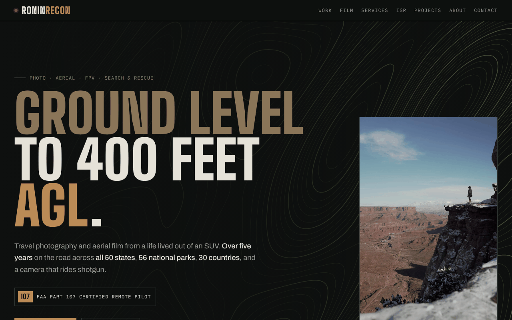
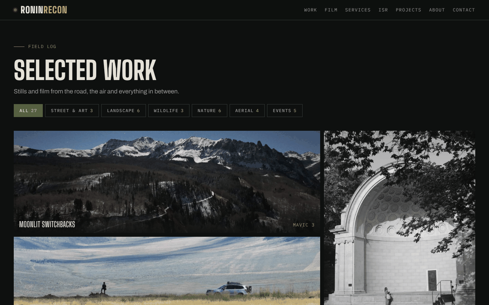
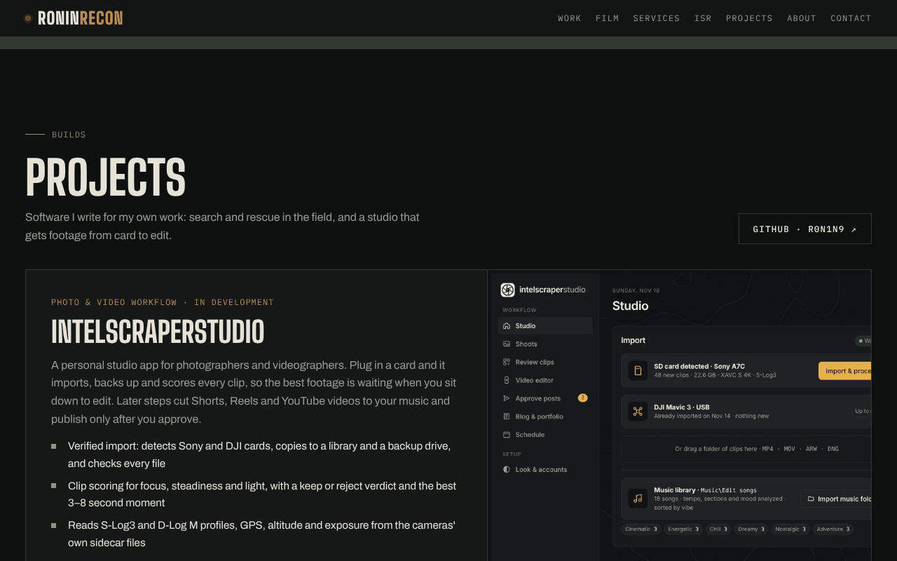

# RoninRecon

Travel photography, aerial film and FAA Part 107 drone work, from ground level to 400 feet.

A [RoninSec](https://r0n1n9.github.io/roninsec/) brand. Live at https://r0n1n9.github.io/roninrecon/

Static site, no build step. `.nojekyll` tells GitHub Pages to serve it as-is.

## Screenshots

| Portfolio | Projects |
|---|---|
|  |  |
| Filterable portfolio of stills and film, from `content/work.json`. | Project cards from `content/projects.json`. |

The page also has Film, Services, Search & Rescue (ISR), Kit, About and Contact sections.

## What lives where

| File | What it controls |
|---|---|
| `content/work.json` | Portfolio tiles: photos, video links, captions, filters |
| `content/projects.json` | Project cards (ISR tools, IntelScraperStudio, …) |
| `content/site.json` | Contact email, Formspree form ID, social handles |
| `media/images/` | Uploaded photos and screenshots |
| `index.html` | Layout, styles, and the fixed text (hero, services, SAR, kit, about) |
| `.pages.yml` | Settings for the browser editor |

## Editing in the browser (Pages CMS)

1. Go to https://app.pagescms.org and sign in with GitHub.
2. Pick the `R0N1N9/roninrecon` repository.
3. Edit **Portfolio**, **Projects** or **Contact & settings**. Upload photos from the image field.
4. Save. The change is committed to GitHub and the live site updates within a minute or two.

Photo tips: export JPGs at about 2000 px on the long edge and under ~1 MB each. Put videos on
YouTube or Vimeo and paste the link into **Video link**.

## Turning on the contact form

The form sends through [Formspree](https://formspree.io), because GitHub Pages has no server.

1. Make a free Formspree account and create a form. Use the email you want messages sent to.
2. Copy the form ID: the code after `formspree.io/f/` in the endpoint.
3. Paste it into **Contact & settings → Formspree form ID** in Pages CMS and save.

Until an ID is set, the form asks visitors to email you instead.

## Editing text by hand

Fixed text lives in `index.html`. Search for the sentence you want to change, edit the words between
the tags, and commit. Anything inside `< >` is structure; leave it alone.

## Previewing locally

`python3 -m http.server 8080` in this folder, then open http://localhost:8080. Opening `index.html`
directly from disk won't load the content files.
